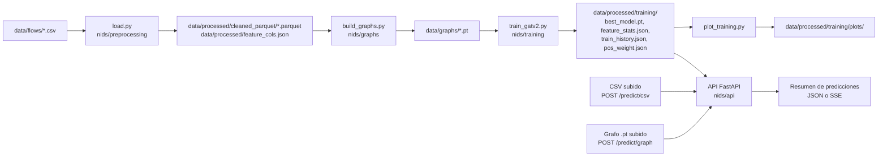

# GATv2-CSE-CIC-IDS2018: NIDS con GNNs

Detección de intrusiones en red con redes de atención sobre grafos (GATv2), entrenadas con flujos del dataset CSE-CIC-IDS2018.

## Qué es y para quién

Proyecto académico en progreso, trabajo final de la asignatura *Proyectos IV*. Convierte flujos de red (ficheros CSV) en grafos por ventanas temporales de 60 segundos y entrena una red GATv2 como baseline de clasificación binaria por nodo (cada nodo es un flujo: `BENIGN` o `ATTACK`).

Está pensado para quien quiera reproducir el pipeline completo, revisar la implementación o usar el modelo entrenado y la API como punto de partida.

## Características

- **Limpieza y etiquetado de flujos CSV**: normaliza la columna `Label`, parsea `Timestamp`, descarta filas con timestamp inválido y genera `label_bin` (`0` = BENIGN, `1` = ATTACK).
- **Tratamiento de `Attempted Category`** configurable con `ATTEMPTED_POLICY`: `ignore`, `drop` o `relabel_benign` (valor por defecto en `load.py`).
- **Dos modos de procesamiento** en `load.py`: `concat` (todo en memoria) o `per_file_parquet` (un parquet por captura, con menos uso de RAM).
- **Construcción de grafos por ventanas** de 60 s y por captura (`build_graphs.py`):
  - Nodos: flujos.
  - Aristas: con los `K_TIME` flujos anteriores en el tiempo y con los últimos `K_IP` flujos de cada IP de origen y de destino. Las aristas son bidireccionales.
  - Las ventanas con más de 25 000 nodos se subdividen, y las ventanas con menos de 50 nodos se descartan.
- **Split por captura** en entrenamiento (train / val / test) y **normalización de features** con media y desviación típica calculadas sobre train.
- **Modelo GATv2** (`nids/training/model.py`): dos capas `GATv2Conv`, 4 cabezas de atención con 32 canales ocultos por cabeza, `LayerNorm`, conexión residual en la primera capa y dropout de 0.2.
- **Entrenamiento** con AdamW y `BCEWithLogitsLoss` ponderada por `pos_weight` (calculado sobre train). Se guarda el mejor epoch según la PR-AUC de validación (en su defecto, la pérdida de entrenamiento).
- **Gráficas** de pérdida, AUC y métricas de validación (`plot_training.py`).
- **API FastAPI** (`nids/api`):
  - `GET /health`.
  - `POST /predict/graph`: sube un grafo `.pt` y devuelve un resumen de predicciones.
  - `POST /predict/csv`: sube un CSV de flujos, lo preprocesa, genera los grafos y devuelve el progreso y el resumen mediante Server-Sent Events (SSE).

## Stack

Versiones fijadas en `requirements.txt`:

| Componente | Versión | Uso |
|---|---|---|
| PyTorch (`torch`) | 2.9.1 | Modelo y entrenamiento |
| PyTorch Geometric (`torch-geometric`) | 2.7.0 | Capas `GATv2Conv` y `DataLoader` de grafos |
| pandas | 2.3.3 | Lectura y limpieza de flujos |
| NumPy | 2.3.5 | Cálculo numérico |
| PyArrow | 22.0.0 | Escritura y lectura de parquet |
| matplotlib | 3.10.8 | Gráficas de entrenamiento |
| FastAPI | 0.128.0 | API de inferencia |
| Uvicorn | 0.30.6 | Servidor ASGI para la API |
| python-multipart | 0.0.12 | Subida de ficheros en la API |
| pytest | 8.3.4 | Tests |

Además, `nids/training/runner.py` importa `scikit-learn` para calcular las métricas ROC-AUC y PR-AUC, pero **no está listado en `requirements.txt`**. Si no está instalado, esas métricas no se calculan.

## Requisitos

- Python 3. El repositorio no declara una versión mínima de Python.
- Las dependencias de `requirements.txt`.
- Ficheros CSV de flujos de CSE-CIC-IDS2018 (versión *Improved*, según la documentación original del proyecto), disponibles en <https://intrusion-detection.distrinet-research.be/CNS2022/Datasets/>. Los CSV **no** se incluyen en el repositorio.
- Los scripts de entrenamiento usan CPU (`DEVICE = "cpu"` en `train_gatv2.py`). El modo `concat` de `load.py` requiere mucha RAM, según indica el propio código. No hay una cifra de RAM documentada.

## Instalación

```bash
git clone https://github.com/jnjambrin0/GATv2-CSE-CIC-IDS2018.git
cd GATv2-CSE-CIC-IDS2018
python -m venv .venv
source .venv/bin/activate
pip install -r requirements.txt
```

## Uso

Todos los scripts usan rutas relativas, así que hay que ejecutarlos desde la raíz del repositorio.

### 1. Preparar los datos

Coloca los CSV en `data/flows/`. El nombre de cada fichero (sin extensión) es el nombre de la captura, y debe coincidir con los nombres de `TRAIN_CAPTURES`, `VAL_CAPTURES` y `TEST_CAPTURES` en `train_gatv2.py` para que se usen en el entrenamiento:

```text
data/flows/
    Wednesday-14-02-2018.csv
    Thursday-15-02-2018.csv
    ...
```

### 2. Pipeline

```bash
# Limpieza, etiquetado y features
python load.py
# Salidas: data/processed/cleaned_parquet/*.parquet y data/processed/feature_cols.json

# Construcción de grafos
python build_graphs.py
# Salidas: data/graphs/*.pt y data/processed/graph_build_report.json

# Entrenamiento del GATv2
python train_gatv2.py
# Salidas en data/processed/training/: best_model.pt, train_history.json,
# feature_stats.json y pos_weight.json

# Gráficas del entrenamiento
python plot_training.py --input data/processed/training/train_history.json
# Salida: data/processed/training/plots/ (loss_curves.png, auc_curves.png, val_metrics.png)
```

Los parámetros de cada script se modifican editando las constantes al inicio del fichero (ver [Configuración](#configuración)). Solo `plot_training.py` acepta argumentos de línea de comandos (`--input` y `--out-dir`).

### 3. API de inferencia

La API necesita `data/processed/training/best_model.pt` y `data/processed/feature_cols.json`. Si existe `data/processed/training/feature_stats.json`, las features se normalizan con él.

```bash
uvicorn nids.api.app:app --reload
```

Uvicorn sirve por defecto en `http://127.0.0.1:8000`. Ejemplos:

```bash
# Comprobación de estado
curl http://127.0.0.1:8000/health

# Predicción sobre un grafo generado por build_graphs.py
curl -F "file=@ruta/al/grafo.pt" http://127.0.0.1:8000/predict/graph

# Predicción sobre un CSV de flujos (respuesta en streaming SSE)
curl -N -F "file=@ruta/al/captura.csv" http://127.0.0.1:8000/predict/csv
```

Las respuestas de `/predict/csv` son eventos SSE: `received`, `preprocess`, `progress`, `completed` o `error`. El umbral de decisión de la API es `0.95` (`THRESHOLD` en `nids/api/config.py`). El preprocesado de la API replica los parámetros de `load.py` y `build_graphs.py`, y CORS permite los orígenes `http://localhost:5173` y `http://127.0.0.1:5173`.

## Configuración

### Variables de entorno

La aplicación no lee variables de entorno. El repositorio no incluye `.env.example`. La única variable que aparece en el código es la de los tests:

| Variable | Obligatoria | Descripción |
|---|---|---|
| `FULL_CSV_TEST` | No | Solo para los tests. Si vale `1`, `test_predict_csv_stream` envía el CSV completo en lugar de una muestra de 2000 filas. |

### Parámetros principales (constantes en el código)

| Fichero | Constante | Valor por defecto | Descripción |
|---|---|---|---|
| `load.py` | `FLOW_DIR` | `data/flows` | Carpeta con los CSV de entrada |
| `load.py` | `PROCESS_MODE` | `per_file_parquet` | `concat` o `per_file_parquet` |
| `load.py` | `DEV_MODE` / `MAX_ROWS_PER_FILE` | `False` / `250000` | Límite de filas por fichero para iterar rápido (solo con `DEV_MODE = True`) |
| `load.py` | `ATTEMPTED_POLICY` | `relabel_benign` | `ignore`, `drop` o `relabel_benign` |
| `build_graphs.py` | `WINDOW_SIZE_SECONDS` | `60` | Tamaño de la ventana temporal |
| `build_graphs.py` | `MIN_NODES_PER_GRAPH` / `MAX_NODES_PER_GRAPH` | `50` / `25000` | Límites de nodos por grafo |
| `build_graphs.py` | `K_IP` / `K_TIME` | `5` / `3` | Número de vecinos por IP y temporales en la construcción de aristas |
| `train_gatv2.py` | `SEED` | `42` | Semilla aleatoria |
| `train_gatv2.py` | `EPOCHS` / `LR` / `WEIGHT_DECAY` | `10` / `1e-3` / `5e-4` | Entrenamiento |
| `train_gatv2.py` | `HEADS` / `HIDDEN_CHANNELS` / `DROPOUT` | `4` / `32` / `0.2` | Arquitectura del GATv2 |
| `nids/api/config.py` | `THRESHOLD` | `0.95` | Umbral de probabilidad para contar un nodo como ataque |
| `nids/api/config.py` | `PROGRESS_EVERY_GRAPHS` | `10` | Cada cuántos grafos se emite un evento `progress` |

## Arquitectura



En `/predict/csv` el CSV subido pasa por el mismo preprocesado y la misma construcción de grafos que en el pipeline, pero en memoria: no escribe los parquet ni los grafos en disco (el CSV subido sí se guarda temporalmente y se borra al terminar).

## Estructura de carpetas

```text
.
├── load.py                  # Paso 1: limpieza, etiquetado y features
├── build_graphs.py          # Paso 2: construcción de grafos
├── train_gatv2.py           # Paso 3: entrenamiento de GATv2
├── plot_training.py         # Paso 4: gráficas del entrenamiento
├── requirements.txt
├── nids/
│   ├── preprocessing/       # config, loader, pipeline, transform
│   ├── graphs/              # builder, config
│   ├── training/            # config, data, model, runner
│   └── api/                 # app, config, pipeline, sse, state
├── tests/                   # conftest.py, test_api_backend.py
└── data/
    └── processed/           # artefactos versionados: feature_cols.json,
                             # graph_build_report.json, preflight_report.json,
                             # training/ (modelo, historial, plots)
```

`data/flows/`, `data/graphs/` y `data/processed/cleaned_parquet/` se generan o se añaden localmente y están excluidos en `.gitignore`.

## Scripts y tests

- **Scripts**: `load.py`, `build_graphs.py`, `train_gatv2.py` y `plot_training.py`, descritos en [Uso](#uso). No hay `Makefile`, `package.json`, `pyproject.toml` ni configuración de CI.
- **Tests**: `pytest -q` (ejecutar desde la raíz). Los tests están en `tests/test_api_backend.py` y prueban la API con `TestClient`:
  - Todos los tests necesitan `data/processed/training/best_model.pt` y `data/processed/feature_cols.json`. Si faltan, se omiten.
  - `/predict/graph` necesita al menos un `.pt` en `data/graphs/`. Si no hay, se omite.
  - `/predict/csv` necesita un CSV en `data/flows/` o `data/flows-improved/`. Si no hay, se omite.

## Licencia

El repositorio no declara licencia.

## Autor

Jaime Navas — [@jnjambrin0](https://github.com/jnjambrin0)
